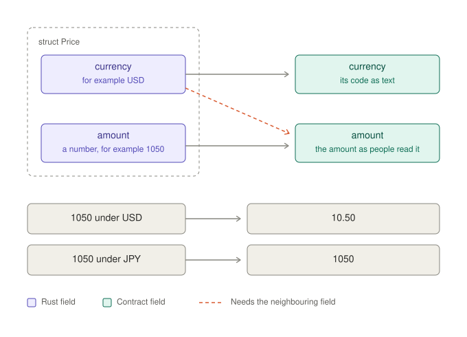

# A value whose meaning depends on its neighbour

**Status: open.** Recorded on 2026-11-23. The library's answer today is a rule
on the field. One alternative was tried on a copy of the repository and works;
it is not implemented. Nothing was added, by decision.

## The problem

A record holds two values of another crate's types. One of them can be shown
on its own. The other cannot: what it means depends on the value beside it.

```rust
pub struct Price {
    pub currency: money::Currency,   // USD, JPY, …
    pub amount: money::Amount,       // a count of the currency's smallest unit
}
```

The contract should show the amount as people read it:

```wit
record price {
  currency: string,
  amount: string,
}
```

The amount `1050` is `10.50` in US dollars and `1050` in Japanese yen. The
number alone does not say which. The currency does.



The grey arrows are conversions that need only the field's own value. The
dashed arrow is the one extra fact: to show the amount, the conversion must
also read the currency.

## What the pattern is called

| Field | Name | What it describes |
| --- | --- | --- |
| Type theory | Dependent pair, or dependent record | The meaning of the second part depends on the value of the first. |
| File formats and protocols | Discriminator, or tag | One field says how to read another. |
| Databases | Functional dependency | The shown value is determined by the pair. Stored next to it, it would be a derived attribute. |
| Serialization | Context-dependent serialization | A value cannot be written without context from outside it. |

This document says discriminator for the field that is read and dependent
value for the one that needs it: `currency` and `amount`.

## Why the library cannot work it out

The library converts each field from that field's value. For `currency` this
is enough, and one entry in the crate's map states it for every `Currency`:

```rust
money::Currency => DisplayText,
```

For `amount` nothing in the types says that the neighbour matters, or which
neighbour. That knowledge is a function of the other crate,
`currency.format(amount)`. It is meaning, not structure.

Two possible additions to Rust would not change this:

- **Compile-time reflection** would tell the library which fields a record has
  and what their types are. It would remove the derives. It cannot reveal what
  a function does with two values.
- **View types**, a proposed addition to the borrow checker, would let a
  method state which fields it reads. That makes the dependency visible in a
  signature. It does not say how the value is computed, and the library would
  still have to be told which method to use.

Both are experimental, and their final form may differ from this description.

## How Rust itself handles it

Rust has no dependent types. It has three techniques, and which one fits
depends on whether the set of cases is closed.

**1. An enum, when the set is closed.** The discriminator and the dependent
value become one value. The dependency is in the type, and the compiler makes
every reader look at the case first.

```rust
enum Price {
    Usd(Cents),
    Jpy(Yen),
}
```

WIT has the same construct, `variant`, and the library maps a Rust enum to it.
A type defined this way needs no rule.

**2. A type that owns both values, when the set is open.** If unknown cases
must survive, an enum does not fit: a value nobody has defined yet has no
case. The two values stay separate fields, and the interpretation is a method
of the type that holds both.

```rust
struct Price {
    currency: Currency,
    amount: Amount,
}

impl Price {
    fn amount_text(&self) -> String {
        self.currency.format(self.amount)
    }
}
```

The dependency is in the method, not in the type.

**3. Explicit context, where there is no room for it.** A function takes the
context as a parameter. A trait such as `Display`, which takes none, is
implemented for an adapter type that carries it. A deserializer takes a seed.

| Rust technique | In the contract |
| --- | --- |
| 1. An enum | No rule; the library handles it. |
| 2. A type with a method | A method cannot cross the boundary. One statement says that the value is shown through it. |
| 3. Explicit context | The same: one statement says where the context comes from. |

The rule this document is about is the contract's counterpart of technique 2.
Rust does not infer the dependency either; the programmer writes the method.

## What works today

A rule on the field. `with` names a function that receives the whole record:

```rust
#[derive(WitType)]
pub struct Price {
    pub currency: money::Currency,
    #[wit(into = String, with = Price::amount_text)]
    pub amount: money::Amount,
}

impl Price {
    fn amount_text(&self) -> String {
        self.currency.format(self.amount)
    }
}
```

What it costs:

- The record's declaration refers to the contract. Every other field of a
  crate with a map is plain Rust.
- A crate that gates its marks behind a feature writes the rule as a long
  `cfg_attr` on the field.
- The statement and its function stand in two places.

## Is this self-referential?

In one sense, and harmlessly. The conversion for `amount` receives the whole
`Price`, and `amount` is a part of it. That is what `&self` means in a method.

- **No cycle.** The conversion reads stored values, never a converted result.
  The library reads the record first and takes it apart afterwards.
- **No recursive type.** `Price` does not contain itself, and neither does the
  contract's record.
- **Nothing is stored.** The record is borrowed for one call.

## Ways to state the dependency

| | What is written | What it says |
| --- | --- | --- |
| 1 | A rule on the field | This field is computed from its record. |
| 2 | `money::Amount in Price => String with \|price\| …` in the map | An amount inside a price is shown this way. |
| 3 | `Price.amount => String with \|price\| …` in the map | This one field of this record is shown this way. |
| 4 | `money::Amount with money::Currency => String with \|amount, currency\| …` in the map | An amount next to a currency is shown this way. |
| 5 | The rule of 1, stated above the record | In this record, this field is computed. |

- **1 and 5 keep the statement with the record.** 5 moves it off the field; the
  record's declaration still refers to the contract.
- **2, 3 and 4 move it into the map.** The record is plain Rust, and the
  statement and its conversion stand in one place.
- **2 names the owner type.** The library can select it by types, as the map
  already does. Two fields of the same type in one owner get the same
  conversion.
- **3 names the field.** It has no such limit, but the map and the derive would
  have to agree on a key made from the field's name.
- **4 names the two types that depend on each other and no owner.** It holds in
  every record that has both, and it is not self-referential. The library would
  have to check every pair of fields of every record.

## Ways to define the type differently

The dependency disappears if the type is defined so that no field needs a
neighbour. Each way moves the cost.

| | The type | Cost |
| --- | --- | --- |
| A | The amount stores its text, filled in when the value is made | Derived data next to its source. With public fields the two can disagree. The Rust type takes the shape of the contract. |
| B | The amount carries its own currency | The currency is stored twice and the copies must be kept equal. |
| C | The text is a property of the price, not of the amount | The contract changes shape: `amount` is a number and `amount-text` a field of its own. A method cannot cross, so the field is still one statement, `#[wit(field(name = "amount-text", into = String, with = Price::amount_text))]`. Possible today. |
| D | An enum whose cases carry the amount | Only for a closed set of cases. An open set, where unknown values must survive, cannot use it. No statement is needed, and the contract shows a `variant`. Possible today. |

A and B remove the statement by making the model worse. C is honest about
where the property belongs and trades one statement for another. D removes
the problem, where the domain allows it.

## What was tried

Way 2, on 2026-11-23, on a copy of the repository.

```rust
representations! {
    pub Representations {
        money {
            money::Currency => DisplayText,
            money::Amount in Price => String with |price| price.currency.format(price.amount),
        }
    }
}
```

How it works:

- An entry with `in Owner` implements a second trait for the map,
  `RepresentsIn<Owner, Foreign>`, whose function takes `&Owner`.
- For each field of a record, the derive asks the compiler one more question
  before the existing one: does the map have an entry for this type inside
  this owner? The answer is a constant, selected the way the existing lookup
  by type is selected.
- With such an entry the value is read from the record before the record is
  taken apart, as a `with` rule's value is. Without one, the lookup by type
  decides as before.

Results on the copy:

| Check | Result |
| --- | --- |
| The fixture's sibling-dependent rule moved into its map | its three generated files unchanged; its value test passes |
| Clippy with warnings denied, all tests | pass |
| A rule on the field | wins over the entry |
| A type entry and an entry inside the owner for one type | the entry inside the owner wins there |
| An entry inside an owner without `with` | compile error at the owner |
| Two fields of that type in the owner | both get the same conversion |

Limits found:

- The entry is keyed by type, so two fields of one type in one owner cannot
  differ. A rule on the field covers that case.
- It applies to the fields of a struct. An entry that names an enum as owner
  would never be used, and nothing would report it.
- Every field of a record in a crate with a map costs one more compile-time
  lookup. Build time was not measured.

## Decision

Nothing was added. The rule on the field works, and a map entry would move one
statement, not remove it. Way 2 is the candidate if the statement should leave
the record's declaration; way 4 if the map should describe the dependency
itself and not where it occurs.
